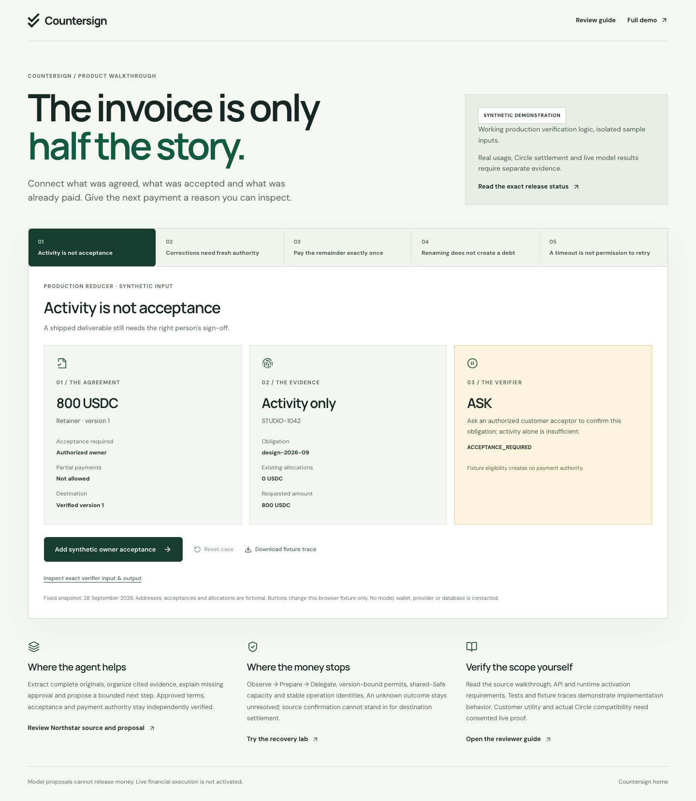
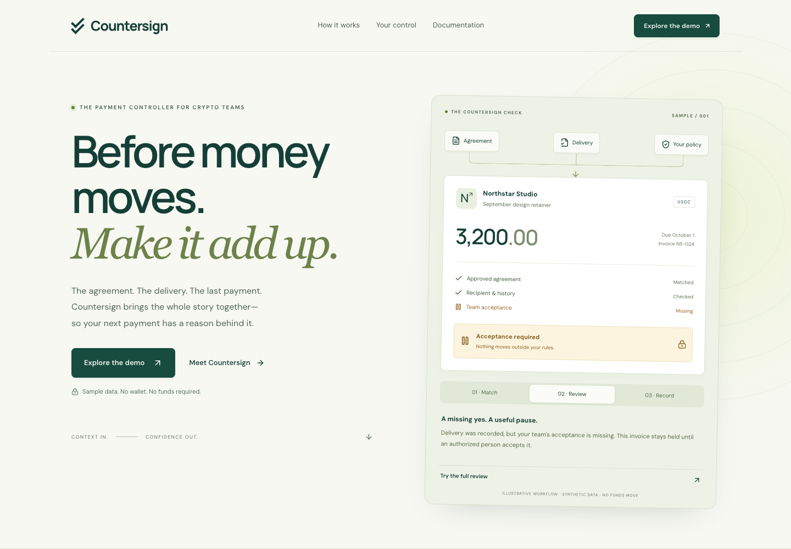
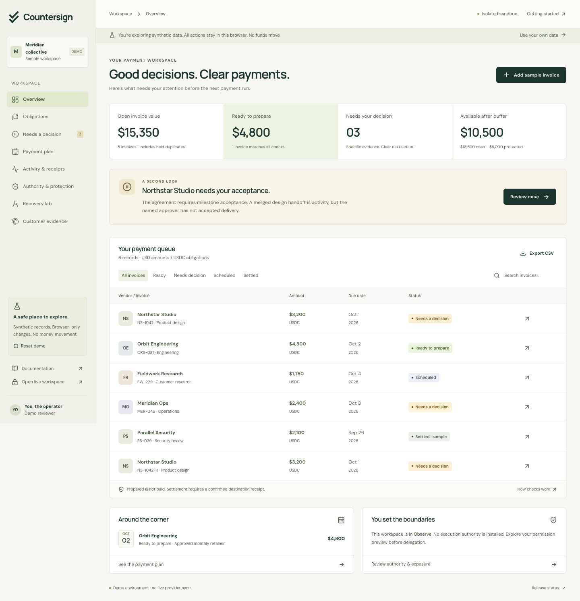
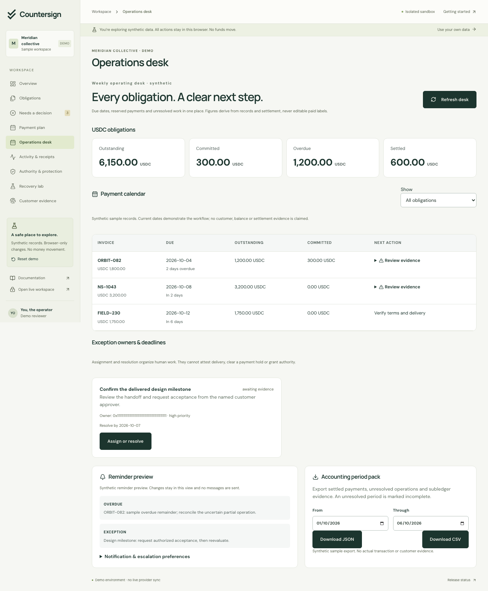
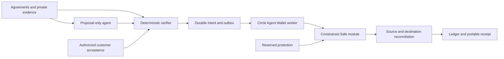

# Countersign

**Before money moves. Make it add up.**

Countersign checks invoices against approved agreements, customer acceptance and prior payments. It brings exceptions into a source-linked review and keeps delegated execution inside explicit Safe limits.

Explore the isolated synthetic workspace without a wallet. The authenticated workspace starts read-only; no sign-in signature gives Countersign access to funds. Source is private at the owner's request.

Version 0.6.1 supports DeepSeek and OpenAI, a private explicitly opted-in actual-model comparison, external EOA sign-in and a clarification loop that reruns deterministic verification after a human answer. A dedicated database and bounded operations host are active with explicitly synthetic records; financial execution remains gated. The reproducible reviewer walkthrough, original proposal provenance, production-planner demo and expiry/Arc observation safeguards remain available. Owner-visible setup, exact schema readiness, scoped operations review and a private pilot measurement kit remain available. Open **Setup** after owner sign-in to distinguish configuration from database readback and external financial authorization.

## Review in three minutes

Start at [the working walkthrough](https://countersign-jet.vercel.app/review): activity versus acceptance, fresh authority after corrections, exact partial allocations, renamed duplicates and operation-preserving timeout recovery. Each case runs production reducers against explicitly synthetic inputs. Inspect or download the full input/output trace, then open [the source and evidence guide](docs/reviewer-guide.md). No wallet is required.

Circle Agent Stack integration is implemented behind reviewed deployment gates. Circle Agent Wallet compatibility, invoice execution, measured model benefit and real business usage remain unproven. A separate manual local-wallet Arc transfer and one synthetic DeepSeek request are recorded compatibility checks. The source remains private pending the owner's public-source/license decision. See [current facts](docs/FACTS.md) and [product vision](VISION.md).

Start a private measurement kit outside this repository with `npm run pilot -- init <new-private-directory>`; follow [the evaluation workflow](docs/evaluation.md) for consent, frozen inputs, timing and exact-asset evidence. Capture and export remain local. The separate `run-arms` command can make one external paid model request only with explicit processing/spend opt-ins and private credentials; it never sends a notice or payment. Observed timing, cost and outcomes are not generated. Separate worker image build/smoke checks and strict provider audits are documented in [deployment](docs/deployment.md) and [security review](docs/security-review.md).

[Live demo](https://countersign-jet.vercel.app) · [Release verification and activation](docs/RELEASE.md)

The operating desk combines due dates, settled and committed balances, exception owners, reminder preferences and accounting period exports. Hourly agreements, versioned invoice corrections and exact partial-payment requests are available through the authenticated console. Optional agreement/invoice extraction stays proposal-only and links to the complete original. [DeepSeek or OpenAI model configuration](docs/deployment.md#optional-model-provider) supports the web assistant and private one-call pilot with provider/model consent binding; no key or paid-provider proof is supplied by source code.

[Explore the operations demo](https://countersign-jet.vercel.app/workspace/operations) · [Activate a real workspace](docs/activation.md) · [Operations desk guide](docs/operations-desk.md)

## Product preview









The screenshots contain fictional sample records. No customer activity or real payment is represented.

## Run locally

```sh
npm ci --ignore-scripts
cp .env.example .env.local
npm run dev
```

Node 22 and Foundry are required for the full verification suite. The landing, documentation and synthetic demo run without credentials. A real workspace requires a dedicated PostgreSQL database and secure environment configuration. Read [deployment guide](docs/deployment.md).

```sh
node --env-file=.env.local --import tsx scripts/migrate.ts
npm run verify
npx playwright install chromium
npm run test:e2e
```

## Architecture



The implementation uses Next.js, TypeScript, PostgreSQL, viem, Circle CLI integration, and minimal Solidity contracts. Integer monetary arithmetic, versioned records, tenant authorization, durable payment IDs, commitment planning, and independent owner recovery are core invariants.

## Documentation

- [Start here](docs/getting-started.md)
- [Agreements and acceptance](docs/agreements.md)
- [Payments and accounting](docs/payments.md)
- [Security and permissions](docs/security.md)
- [Contracts and exact permit fields](docs/contracts.md)
- [Integration setup](docs/integrations.md)
- [API reference](docs/api.md)
- [Recovery playbook](docs/recovery.md)
- [Receipt verifier](docs/receipts.md)
- [Reserved protection](docs/protection.md)
- [Evidence and evaluation](docs/evaluation.md)
- [Verified facts and external gates](docs/FACTS.md)
- [Activation diagnostics and restore rehearsal](docs/activation.md)
- [Operations desk and accounting period packs](docs/operations-desk.md)

## Public handbook and machine-readable documentation

The handbook at `/docs` contains 32 guides and articles with full-text search, section links, copy-as-Markdown, and mobile navigation. Topics cover intake through settlement, operational controls, API usage, and practical adoption. The same allowlisted Markdown files power every reading surface.

- `/llms.txt` is the discovery index, with descriptions and absolute Markdown links.
- `/llms-full.txt` contains the complete public handbook, with source URLs and availability boundaries.
- `/docs/raw/{slug}` serves an individual guide as `text/markdown`.
- `/sitemap.xml` lists the public pages; private application routes are excluded from crawler discovery.

Add public guides in `src/lib/content/guides.ts` and their Markdown in `docs/`. Keep internal strategy, credentials, and private customer information outside this registry. The content check verifies allowlisted file names, internal guide links, headings, and fenced examples. Never infer production readiness from documentation availability.

## Verification boundaries

Unit, PostgreSQL-semantic integration, contract fuzz/invariant and browser tests exercise the software locally. They do not establish live Circle compatibility, a mainnet deployment, customer traction or an independent audit. Live execution remains gated until its exact deployment and authority are verified. No funded protection is advertised.

The demo stores only labeled synthetic examples in local browser storage. Production records must use PostgreSQL; no memory or browser fallback is permitted. A public receipt is tamper-evident relative to its trusted commitment, not proof that work was delivered.

## License

All rights reserved pending an explicit source-license decision. Third-party dependencies retain their own licenses. Contract dependency versions and licenses are recorded under contracts/lib. No open-source participation commitment is implied by this private repository.
