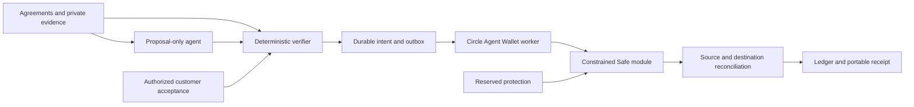

# Countersign

**Pay what you agreed. Know why.**

Countersign checks invoices against approved agreements, customer acceptance and prior payments. It brings exceptions into a source-linked review and keeps delegated execution inside explicit Safe limits.

Explore the isolated synthetic workspace without a wallet. The authenticated workspace starts read-only; no sign-in signature gives Countersign access to funds. Source is private at the owner's request.

[Live demo](https://countersign-jet.vercel.app) · [Release verification and activation](docs/RELEASE.md)

## Product preview


The workspace screenshot contains fictional sample records. No customer activity or real payment is represented.

## Run locally

```sh
npm ci --ignore-scripts
cp .env.example .env.local
npm run dev
```

Node 22 and Foundry are required for the full verification suite. The landing, documentation and synthetic demo run without credentials. A real workspace requires a dedicated PostgreSQL database and secure environment configuration. Read [deployment guide](docs/deployment.md).

```sh
node --env-file=.env.local --import tsx scripts/migrate.ts
npm run verify
npx playwright install chromium
npm run test:e2e
```

## Architecture



The implementation uses Next.js, TypeScript, PostgreSQL, viem, Circle CLI integration, and minimal Solidity contracts. Integer monetary arithmetic, versioned records, tenant authorization, durable payment IDs, commitment planning, and independent owner recovery are core invariants.

## Documentation

- [Start here](docs/getting-started.md)
- [Agreements and acceptance](docs/agreements.md)
- [Payments and accounting](docs/payments.md)
- [Security and permissions](docs/security.md)
- [Contracts and exact permit fields](docs/contracts.md)
- [Integration setup](docs/integrations.md)
- [API reference](docs/api.md)
- [Recovery playbook](docs/recovery.md)
- [Receipt verifier](docs/receipts.md)
- [Reserved protection](docs/protection.md)
- [Evidence and evaluation](docs/evaluation.md)
- [Verified facts and external gates](docs/FACTS.md)

## Verification boundaries

Unit, PostgreSQL-semantic integration, contract fuzz/invariant and browser tests exercise the software locally. They do not establish live Circle compatibility, a mainnet deployment, customer traction or an independent audit. Live execution remains gated until its exact deployment and authority are verified. No funded protection is advertised.

The demo stores only labeled synthetic examples in local browser storage. Production records must use PostgreSQL; no memory or browser fallback is permitted. A public receipt is tamper-evident relative to its trusted commitment, not proof that work was delivered.

## License

All rights reserved pending an explicit source-license decision. Third-party dependencies retain their own licenses. Contract dependency versions and licenses are recorded under contracts/lib. No open-source participation commitment is implied by this private repository.
